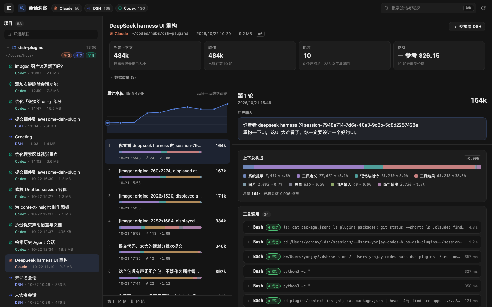

English | [简体中文](./README.zh.md)

# Cyrus Plugins · @cyrus/dsh-plugins

A plugin collection for DeepSeek Harness (DSH). Install this one bundle to get every plugin listed below; each plugin can also be installed on its own.



## Plugins

| Plugin                                                 | npm package                  | What it does                                                                                                                                  |
| ------------------------------------------------------ | ---------------------------- | --------------------------------------------------------------------------------------------------------------------------------------------- |
| [Sessions Insight](./plugins/sessions-insight/README.en.md) | `@cyrus/dsh-sessions-insight` | Opens up what each turn of a Claude Code, DSH or Codex session actually fed the model: composition, tool calls, compactions, cost. Includes confirmed session deletion. |

## Install

Requires DSH 0.2.1-rc.2 or newer (see `docs/adr/0002-asar-021-is-the-contract.md`). First decide which profile to install into: the desktop app uses `desktop`, `dsh web` on the command line uses `web`. Installing into the wrong profile does not error; the plugin just never shows up.

**Install the collection (recommended)** to get every plugin at once; when a plugin is added to the collection later, upgrading the collection brings it in.

```bash
dsh plugin --profile desktop add @cyrus/dsh-plugins
```

**Install a single plugin**:

```bash
dsh plugin --profile desktop add @cyrus/dsh-sessions-insight
```

Then **fully quit and reopen** DSH. "Cyrus Plugins" or "Sessions Insight" in the plugin manager means it worked.

> **Pick one of the two.** The collection and the standalone plugin insert the same id into the loader tree; with both in `dsh.profile.bundles`, DSH fails at boot with `duplicate loader entry id`. Run `dsh plugin --profile <name> remove` on one before switching to the other.
>
> Do not install from the git URL (`pnpm add https://github.com/...`): the root depends on `workspace:^`, which is only rewritten to a version number when publishing to npm.

**Installing from this working tree (developing the collection)**: the desktop plugin manager's "Add plugin" also accepts a local directory — point it at this checkout's absolute path. DSH records it as `"@cyrus/dsh-plugins": "link:<that path>"`: a symlink into your working tree, not a copy, and nothing is built for you. The host resolves `lib/index.js` through that link, and `lib/` is gitignored, so build it first:

```bash
npx tsdown
```

Then fully quit and reopen DSH. Later edits only need a rebuild and a restart — there is no need to reinstall.

Each plugin's usage, permission boundary and known limitations live in its own README.

## Repository layout

This is a pnpm monorepo. Only the collection and `plugins/*` are published; the rest is inlined into the plugins at build time.

| Path                         | Contents                                                                  | Published                             |
| ---------------------------- | ------------------------------------------------------------------------- | ------------------------------------- |
| `/` (root)                   | The collection bundle: `cordis.patch.yml` + `locale/`                     | **yes**, `@cyrus/dsh-plugins`         |
| `plugins/sessions-insight`    | The Sessions Insight plugin: host half and browser half                       | **yes**, `@cyrus/dsh-sessions-insight` |
| `packages/session-contract`  | The unified IR, wire types and their guards                               | no                                    |
| `packages/session-readers`   | Claude Code / Codex / DSH readers                                         | no                                    |
| `packages/plugin-kit`        | Plugin-agnostic JSON envelope and URL spelling                            | no                                    |
| `packages/plugin-kit-host`   | Host-half plumbing: route table, same-origin gate, envelope, LRU          | no                                    |
| `packages/plugin-kit-client` | Browser-half plumbing: decoding fetch, style injection, slot registration | no                                    |
| `apps/preview`               | Local preview harness on `:5178`                                          | no                                    |
| `scripts`                    | CSS build, bundle-contract check, install script, session probes          | no                                    |
| `tooling`                    | Package alias table, tsconfig base, tsdown config                         | no                                    |

Dependencies point one way only: `plugins/* → packages/*`. The package-name-to-source mapping lives in `tooling/aliases.ts`, and `tsconfig.json`'s `paths` mirrors it, so tests, the preview app and the build never need the internal packages built first.

## Development

```bash
pnpm install
```

```bash
pnpm dev
```

The preview runs at <http://localhost:5178> and reads your real local sessions; add `?theme=light` or `?theme=dark` to switch themes.

Run the gates before you commit:

```bash
npx tsc --noEmit && npx tsc --noEmit -p tsconfig.client.json && npx vitest run && npx tsdown && node scripts/check-bundle.mjs plugins/sessions-insight
```

Rebuild the artifacts and check that the profile's link really points at your build (this does not install — installation happens in the DSH plugin manager):

```bash
pnpm install:plugin
```

Regenerate the README screenshots from the preview (headless Chrome, 1440×900; add `-- --theme light` for the light theme). They show the sessions on your machine, so look at them before committing:

```bash
pnpm screenshots
```

## Publishing

Follow [`docs/RELEASE.md`](./docs/RELEASE.md): the plugin first, then the collection.

## Documentation

- [`docs/RELEASE.md`](./docs/RELEASE.md) — publishing to npm
- `docs/PLAN.md` — decisions and milestones (Chinese)
- `docs/IR.md` — the unified turn IR, the adapter contract (Chinese)
- `docs/API.md` — host route contract (Chinese)
- `docs/HANDOFF.md` — handoff contract (Chinese)
- `docs/adr/` — architecture decision records (Chinese)
- `GLOSSARY.md` — vocabulary (Chinese)

## License

[MIT](./LICENSE)
