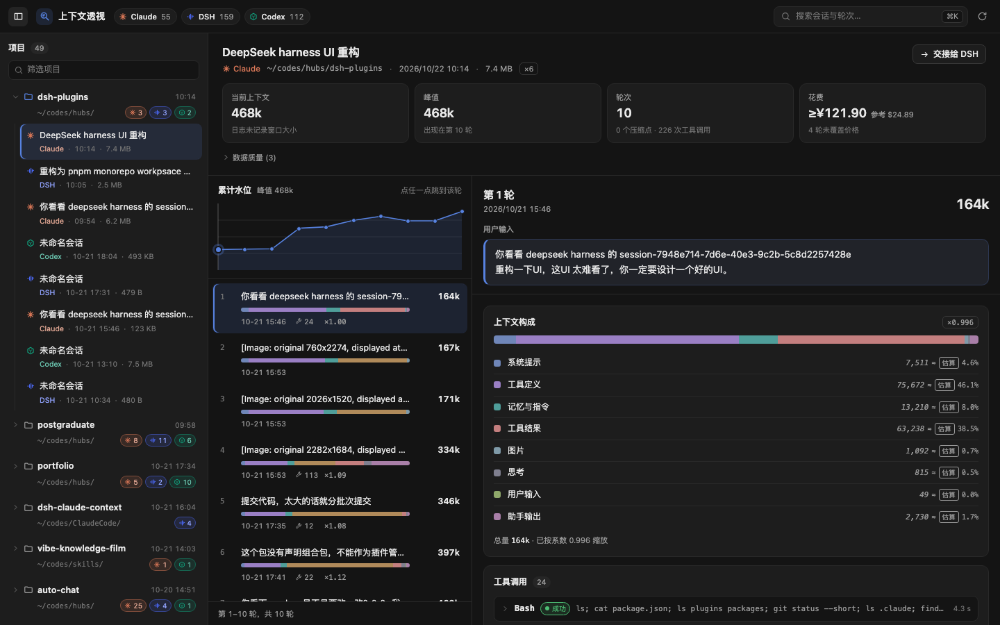

[English](./README.md) | 简体中文

# Cyrus 插件集 · @cyrus/dsh-plugins

给 DeepSeek Harness（DSH）用的插件合集。装这一个组合包，就装上下面列出的全部插件；每个插件也可以单独安装。



## 包含的插件

| 插件                                                              | npm 包                       | 做什么                                                                                                        |
| ----------------------------------------------------------------- | ---------------------------- | ------------------------------------------------------------------------------------------------------------- |
| [上下文透视（Context Lens）](./plugins/context-insight/README.md) | `@cyrus/dsh-context-insight` | 把 Claude Code / DSH / Codex 三源会话每一轮实际喂给模型的上下文拆开看：构成、工具调用、压缩点、费用，全程只读 |

## 安装

需要 DSH 0.2.1-rc.2 或更高（见 `docs/adr/0002-asar-021-is-the-contract.md`）。先确认装进哪个 profile：双击桌面端是 `desktop`，命令行 `dsh web` 是 `web`。装错 profile 不报错，只是插件不出现。

**装组合包（推荐）**：一次装上全部插件，以后合集里加了新插件，升级组合包就能拿到。

```bash
dsh plugin --profile desktop add @cyrus/dsh-plugins
```

**只装某一个插件**：

```bash
dsh plugin --profile desktop add @cyrus/dsh-context-insight
```

装完**完全退出再重新打开** DSH；插件管理器里出现「Cyrus 插件集」或「上下文透视」即成功。

> **两种方式只能选一种。** 组合包和单独的插件会往加载树里插同一个 id，两个都在 `dsh.profile.bundles` 里时 DSH 启动会报 `duplicate loader entry id` 并退出。换方式前先 `dsh plugin --profile <name> remove` 掉另一个。
>
> 不要用 git 地址安装（`pnpm add https://github.com/...`）：仓库根的依赖写的是 `workspace:^`，只有发布到 npm 时才会被改写成版本号。

每个插件的用法、权限边界和已知限制，看它自己的 README。

## 仓库结构

这是一个 pnpm monorepo。对外发布的只有组合包和 `plugins/*`，其余在构建时内联进插件。

| 目录                         | 内容                                           | 发布                                 |
| ---------------------------- | ---------------------------------------------- | ------------------------------------ |
| `/`（仓库根）                | 组合包：`cordis.patch.yml` + `locale/`         | **是**，`@cyrus/dsh-plugins`         |
| `plugins/context-insight`    | 上下文透视插件：宿主半边 + 浏览器半边          | **是**，`@cyrus/dsh-context-insight` |
| `packages/session-contract`  | 统一 IR、线上类型与解码守卫                    | 否                                   |
| `packages/session-readers`   | Claude Code / Codex / DSH 三源适配             | 否                                   |
| `packages/plugin-kit`        | 插件无关的 JSON 信封与 URL 约定                | 否                                   |
| `packages/plugin-kit-host`   | 宿主半边管线：路由表、同源门、信封、LRU        | 否                                   |
| `packages/plugin-kit-client` | 浏览器半边管线：解码 fetch、样式注入、槽位注册 | 否                                   |
| `apps/preview`               | 本地预览 harness（`:5178`）                    | 否                                   |
| `scripts`                    | 构建 CSS、校验打包契约、安装脚本、会话探针     | 否                                   |
| `tooling`                    | 包名别名表、tsconfig base、tsdown 配置         | 否                                   |

依赖只有一个方向：`plugins/* → packages/*`。包名到源码的映射集中在 `tooling/aliases.ts`，`tsconfig.json` 的 `paths` 与之对应，所以测试、预览、打包都不需要先构建内部包。

## 开发

```bash
pnpm install
```

```bash
pnpm dev
```

预览页在 <http://localhost:5178>，读本机真实会话；加 `?theme=light` 或 `?theme=dark` 切主题。

提交前跑一遍门禁：

```bash
npx tsc --noEmit && npx tsc --noEmit -p tsconfig.client.json && npx vitest run && npx tsdown && node scripts/check-bundle.mjs plugins/context-insight
```

把当前工作区装进本机 DSH 验证（会打包、安装，并校验装进去的确实是新构建）：

```bash
pnpm install:plugin
```

从预览页重新生成 README 截图（headless Chrome，1440×900；要浅色主题就加 `-- --theme light`）。截图里是你本机的真实会话，提交前看一眼：

```bash
pnpm screenshots
```

## 发布

按 [`docs/RELEASE.zh.md`](./docs/RELEASE.zh.md) 的步骤来：先发插件，再发组合包。

## 文档

- [`docs/RELEASE.zh.md`](./docs/RELEASE.zh.md) — npm 发布步骤
- [`docs/PLAN.md`](docs/PLAN.md) — 决策与里程碑
- [`docs/IR.md`](docs/IR.md) — 三源统一的轮次 IR（adapter 契约）
- [`docs/API.md`](docs/API.md) — 宿主路由契约
- [`docs/HANDOFF.md`](docs/HANDOFF.md) — 交接链路契约
- [`docs/adr/`](docs/adr/)— 架构决策记录
- [`GLOSSARY.md`](GLOSSARY.md) — 词表

## 许可

[MIT](./LICENSE)
