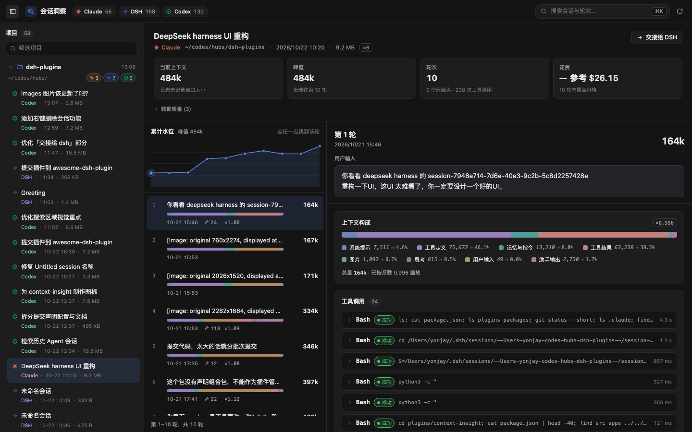

[English](./README.md) | 简体中文

# Cyrus 插件集 · @cyrusdoyle/dsh-plugins

给 DeepSeek Harness（DSH）用的插件合集。装这一个组合包，就装上下面列出的全部插件；每个插件也可以单独安装。



## 包含的插件

| 插件                                                              | npm 包                       | 做什么                                                                                                        |
| ----------------------------------------------------------------- | ---------------------------- | ------------------------------------------------------------------------------------------------------------- |
| [会话洞察（Sessions Insight）](./plugins/sessions-insight/README.zh.md) | `@cyrusdoyle/dsh-sessions-insight` | 把 Claude Code / DSH / Codex 三源会话每一轮实际喂给模型的上下文拆开看：构成、工具调用、压缩点、费用，支持确认后删除会话 |

## 安装

需要 DSH 0.2.1-rc.5 或更高（见 `docs/adr/0002-asar-021-is-the-contract.md`）。先确认装进哪个 profile：双击桌面端是 `desktop`，命令行 `dsh web` 是 `web`。装错 profile 不报错，只是插件不出现。

**装组合包（推荐）**：一次装上全部插件，以后合集里加了新插件，升级组合包就能拿到。

```bash
dsh plugin --profile desktop add @cyrusdoyle/dsh-plugins   # 桌面端
dsh plugin --profile web     add @cyrusdoyle/dsh-plugins   # dsh web
```

**只装某一个插件**：

```bash
dsh plugin --profile desktop add @cyrusdoyle/dsh-sessions-insight   # 桌面端
dsh plugin --profile web     add @cyrusdoyle/dsh-sessions-insight   # dsh web
```

装完**完全退出再重新打开** DSH；插件管理器里出现「Cyrus 插件集」或「会话洞察」即成功。

> **两种方式只能选一种。** 组合包和单独的插件会往加载树里插同一个 id，两个都在 `dsh.profile.bundles` 里时 DSH 启动会报 `duplicate loader entry id` 并退出。换方式前先 `dsh plugin --profile <name> remove` 掉另一个。
>
> **Git 安装只支持单独的成员包，不支持组合包。** `plugins/sessions-insight/lib/` 随源码入库，所以成员包可以直接从这个仓库安装、不需要执行构建脚本——例如 `dsh plugin --profile desktop add github:Mt-Youya/dsh-plugins#path:/plugins/sessions-insight`，或者在插件管理器里指向该目录的本地 checkout。组合包不能从 Git 安装：仓库根的依赖写的是 `workspace:^`，只有 `pnpm pack` / 发布时才会被改写成版本号。组合包请从 npm 安装，或按下面的说明 link 本工作区。

**从当前工作区安装（开发这个合集时）**：桌面端插件管理器的「添加插件」也接受本地目录，填本仓库的绝对路径即可。DSH 会把它记成 `"@cyrusdoyle/dsh-plugins": "link:<那个路径>"` —— 一条指向你工作区的软链，不是拷贝，也不会替你做任何构建。宿主就是通过这条软链读 `lib/index.js`，而 `lib/` 在 .gitignore 里，所以先构建（组合包会内联编译后的样式，CSS 必须先生成）：

```bash
node scripts/build-css.mjs plugins/sessions-insight && npx tsdown --minify
```

然后完全退出再重新打开 DSH。之后改代码只需要重建 + 重启，不用重新安装。

每个插件的用法、权限边界和已知限制，看它自己的 README。

## 设置、余额与版本检查

组合包内嵌的是与单独安装的成员包相同的插件源码（ADR 0009），所以运行行为就是「会话洞察」的行为：只读洞察、交接、确认删除，加上一个设置页和两个需要手动开启的辅助功能。

- **设置由宿主保存。** `/api/dsh-sessions-insight/settings` 只读；六个开关（会话概览、Skills 标签、累计水位图、默认展开工具列表、余额显示、自动检查版本）通过宿主的配置表单写入并保存在宿主，插件不写任何配置文件。
- **余额与版本检查默认关闭。** 主动打开开关、或按下对应按钮，才会让插件发起外部请求。出站只有两个固定 HTTPS 地址：`https://api.deepseek.com/user/balance` 和 `https://registry.npmjs.org/@cyrusdoyle%2F.../latest`，无重定向、无 cookie、URL 不可由调用方指定。
- **凭据**：余额检查使用 DeepSeek 官方适配器配置的凭据引用（`apiKeyEnv`，默认 `DEEPSEEK_API_KEY`），没有配置时使用已登录的 DeepSeek 账号；不跟随自定义 provider 的引用。插件不保存、不记录密钥。
- **读取面不改写源日志。** 写操作只有交接相关路由——`handoff/apply` 通过官方 `session.create` + `session.prompt` 投递简报，`handoff/reveal` 创建/复用工作区让已有 DSH 会话可见——以及确认后的删除会话。`/balance` 额外只接受 loopback 来源——宿主的 webserver 没有全站鉴权。
- **需要 DSH 0.2.1-rc.5+**：设置页依赖该版本才有的 `configForms` 客户端服务与 `plugins.bundle.config` 槽位。

完整的路由清单、默认值和已知限制见插件 README。

## 仓库结构

这是一个 pnpm monorepo。对外发布的只有组合包和 `plugins/*`，其余在构建时内联进插件。

| 目录                         | 内容                                           | 发布                                 |
| ---------------------------- | ---------------------------------------------- | ------------------------------------ |
| `/`（仓库根）                | 组合包：`cordis.patch.yml`、`locale/`、自己的 `lib/` | **是**，`@cyrusdoyle/dsh-plugins`         |
| `plugins/sessions-insight`    | 会话洞察插件：宿主半边 + 浏览器半边          | **是**，`@cyrusdoyle/dsh-sessions-insight` |
| `packages/session-contract`  | 统一 IR、线上类型与解码守卫                    | 否                                   |
| `packages/session-readers`   | Claude Code / Codex / DSH 三源适配             | 否                                   |
| `packages/plugin-kit`        | 插件无关的 JSON 信封与 URL 约定                | 否                                   |
| `packages/plugin-kit-host`   | 宿主半边管线：路由表、同源门、信封、LRU        | 否                                   |
| `packages/plugin-kit-client` | 浏览器半边管线：解码 fetch、样式注入、槽位注册 | 否                                   |
| `apps/preview`               | 本地预览 harness（`:5178`）                    | 否                                   |
| `scripts`                    | 构建 CSS、校验打包契约、安装脚本、会话探针     | 否                                   |
| `tooling`                    | 包名别名表、tsconfig base、tsdown 配置         | 否                                   |

依赖只有一个方向：`plugins/* → packages/*`。包名到源码的映射集中在 `tooling/aliases.ts`，`tsconfig.json` 的 `paths` 与之对应，所以测试、预览、打包都不需要先构建内部包。

## 开发

```bash
pnpm install
```

```bash
pnpm dev
```

预览页在 <http://localhost:5178>，读本机真实会话；加 `?theme=light` 或 `?theme=dark` 切主题。

提交前跑一遍门禁：

```bash
npx tsc --noEmit && npx tsc --noEmit -p tsconfig.client.json && npx vitest run && node scripts/build-css.mjs plugins/sessions-insight && npx tsdown --minify && node scripts/check-bundle.mjs plugins/sessions-insight && node scripts/check-bundle.mjs .
```

CI 跑同一套门禁，另外会在「重建后的 `plugins/sessions-insight/lib/` 与提交内容不一致」时失败——见 [`.github/workflows/ci.yml`](./.github/workflows/ci.yml)。

重建产物，并校验 profile 里那条软链确实指向你的构建（这一步不安装 —— 安装走 DSH 插件管理器）：

```bash
pnpm install:plugin
```

从预览页重新生成 README 截图（headless Chrome，1440×900；要浅色主题就加 `-- --theme light`）。截图里是你本机的真实会话，提交前看一眼：

```bash
pnpm screenshots
```

可选浏览器检查（需要本机 Chrome，不在 CI 里跑）：

- `pnpm smoke:preview` 用 `?probe=1` 在明暗两套主题下测量已挂载的面板。
- `pnpm check:ui` 对本地起的 fixture 服务跑会话菜单交互回归。

## 发布

按 [`docs/RELEASE.zh.md`](./docs/RELEASE.zh.md) 的步骤来：成员包和组合包共用一个版本号、成对发布，先发成员包（ADR 0010）。

## 文档

- [`docs/RELEASE.zh.md`](./docs/RELEASE.zh.md) — npm 发布步骤
- [`docs/PLAN.md`](docs/PLAN.md) — 决策与里程碑
- [`docs/IR.md`](docs/IR.md) — 三源统一的轮次 IR（adapter 契约）
- [`docs/API.md`](docs/API.md) — 宿主路由契约
- [`docs/HANDOFF.md`](docs/HANDOFF.md) — 交接链路契约
- [`docs/adr/`](docs/adr/)— 架构决策记录
- [`GLOSSARY.md`](GLOSSARY.md) — 词表

## 许可

[MIT](./LICENSE)

## Star History

<a href="https://www.star-history.com/?repos=Mt-Youya%2Fdsh-plugins">
 <picture>
   <source media="(prefers-color-scheme: dark)" srcset="https://api.star-history.com/chart?repos=Mt-Youya/dsh-plugins&type=date&theme=dark&legend=top-left" />
   <source media="(prefers-color-scheme: light)" srcset="https://api.star-history.com/chart?repos=Mt-Youya/dsh-plugins&type=date&legend=top-left" />
   
 </picture>
</a>
