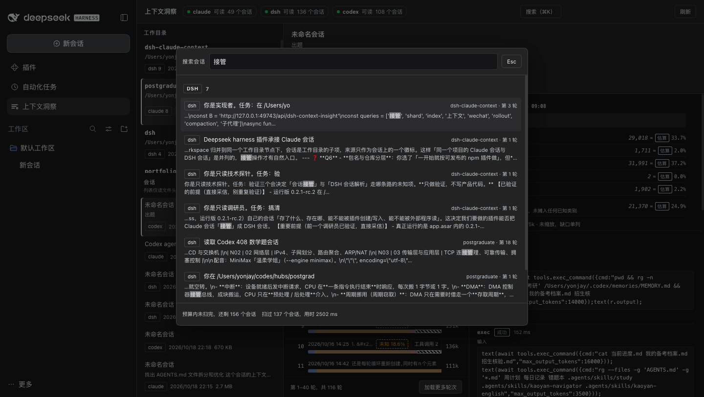

# Context Insight · dsh-context-insight

A read-only **context insight** panel for the DSH Web GUI. It parses session logs from **Claude Code, DSH and Codex** and shows what the model actually received on each turn — system prompt, tool definitions, memory & instructions, history, tool results, images — and marks every number as an exact usage figure or a character-based estimate.


> Read-only end to end: no writes to source data, no index, nothing persisted. The only cache is an in-process LRU.

> **Scope of v0.1.0**: read-only insight plus the summary handoff. The handoff delivers a generated brief into a new DSH session and **only calls the official `session.create` / `session.prompt`** — it never hand-writes session events and never rewrites the source session (`docs/HANDOFF.md`, `docs/adr/0003-never-handwrite-session-events.md`, `docs/adr/0007-accepted-is-not-success.md`).

## What it answers

- Of this turn's 392K window, how much is tool schemas, and how much is history?
- Why does the window jump after turn 7 — where is the compaction point, and what were the sizes before and after?
- Is 29,018 a usage figure from the log or a chars/token estimate? Every value carries an `exact` / `estimate` badge plus its basis.
- Across all three sources, how many sessions and turns does a workdir hold, and when was it last touched?


## Navigation

**The workdir is the only axis; the source is just a badge.**

`workdir → session → turn`

- The session list reads **file headers only**; a session is parsed when you open it, so the first open of a big file pays the decode cost.
- Turns paginate 40 at a time, with "load more turns" at the bottom.
- The "cumulative water level" chart plots each turn's total context; dashed vertical rules mark compaction points.
- The right-hand pane shows composition blocks, data-quality flags, tool calls (name / status / duration / input & output) and the subagent tree.
- `⌘K` (`Ctrl+K` on Windows/Linux) opens full-corpus search; a hit jumps straight to that turn.



## Sources and their roots

| Source      | Default root         | Override                          |
| ----------- | -------------------- | --------------------------------- |
| Claude Code | `~/.claude/projects` | `DSH_CONTEXT_INSIGHT_CLAUDE_ROOT` |
| DSH         | `~/.dsh/sessions`    | `DSH_CONTEXT_INSIGHT_DSH_ROOT`    |
| Codex       | `~/.codex/sessions`  | `DSH_CONTEXT_INSIGHT_CODEX_ROOT`  |

A missing or unreadable source never takes the others down: the strip at the top marks just that source "unavailable" and gives the reason (root missing / unreadable / adapter error).

## Install

Requires DSH **0.2.1-rc.2 or newer** (the plugin is aligned with the behaviour of the running `app.asar`; see `docs/adr/0002-asar-021-is-the-contract.md`).

**Step 1 — install into the profile**

```sh
dsh plugin --profile web add @cyrus/dsh-context-insight
# from a checkout, or from a packed tarball:
# dsh plugin --profile web add link:$PWD
# dsh plugin --profile web add /abs/path/cyrus-dsh-context-insight-0.1.0.tgz
```

**Step 2 — make sure the package is listed in `dsh.profile.bundles`**

In practice `dsh plugin ... add` also appends the package name to the end of `dsh.profile.bundles` in `~/.dsh/profiles/web/package.json`. If it did not (a `link:` install, a hand-edited manifest, or an upgrade from an older layout), add it yourself — order matters, later layers override earlier ones:

```json
{
  "dsh": {
    "profile": {
      "bundles": ["@deepseek-ai/dsh-base", "@deepseek-ai/dsh-web-app", "@cyrus/dsh-context-insight"]
    }
  }
}
```

**Step 3 — restart**

```sh
dsh web
```

A "Context insight" row in the sidebar means it mounted. Host-side smoke test (a request without an `Origin` header counts as same-origin):

```sh
curl -sS http://127.0.0.1:<port>/api/dsh-context-insight/health
# {"ok":true,"value":{"version":"0.0.1","sources":["claude","dsh","codex"]}}
# value.version comes from the host-side PLUGIN_VERSION constant, not package.json
```

> Loader rows are composed at boot, so **a restart is required**. Browser hot-reload only covers a rebuilt client bundle.

## Permissions and security boundary

- **Read-only**: the three roots are only `stat`-ed and read; nothing is written, deleted or renamed.
- **Nothing persisted**: no index, no cache files; the in-process LRU keys on `source + id + mtime + size`.
- **Path allowlist**: every path argument is resolved and `realpath`-checked to stay inside the three allowed roots, which blocks `..` and symlink escapes.
- **Same-origin gate**: every route is `kind:'exact'` and passes an Origin/Host gate first — `Sec-Fetch-Site: cross-site` is a 403, a mismatched `Origin`/`Host` is a 403, a same-origin GET without `Origin` passes.
- **The only write path is the handoff**: the query surface is all GETs (`health` / `sources` / `workdirs` / `sessions` / `session` / `search` / `cost`); the single write action is `handoff/apply`, which only calls the official `session.create` + `session.prompt` — it writes no source data and injects no events into a live session.
- **Read limits**: single-file decoding is byte-capped and answers `read-limit` instead of starving the Host.

## Known limitations

1. **Search has a 2.5 s budget.** Full-corpus search streams and stops at `SEARCH_DEADLINE_MS = 2500`: the response carries `truncated: true` and `remaining` (sessions not reached), and the UI says "not finished within budget, N sessions left". On a very large corpus, narrow the sources or drill down by workdir instead.
2. **Claude sessions without `prompt_snapshot` show a large "unknown" slice.** Those sessions (56 of 121 files in this corpus) cannot see tool definitions or the system prompt, so that share stays in `residual` and is drawn as an explicit "unknown" slice — it is **never** smeared into the other categories on purpose. See `docs/adr/0005-honest-attribution-residual.md`.
3. **Codex reasoning is unavailable.** `response_item.reasoning.encrypted_content` is ciphertext: countable, not measurable, so Codex turns show no "thinking" block.
4. **Blocks are estimates; totals are exact.** Blocks use 2.6 chars/token, which runs ~23% high on instruction bodies; turns that were equalised carry a `reconciled.factor` (see `docs/adr/0006-projection-not-differencing.md`). Do not bill from block numbers.
5. **DSH bodies require decoding the log.** The projcache holds metadata only, so opening a session still means frame-by-frame zstd decoding; multi-MB sessions pause noticeably on first open.

## Layout

This package owns the plugin's two halves; the capabilities live in the workspace packages it depends on. Dependencies point one way — `plugins/context-insight → packages/*` — and the mapping from package name to source lives in `tooling/aliases.ts`, mirrored by `paths` in `tsconfig.json`.

**This package**, `plugins/context-insight/src/`:

```
src/
├── index.ts          host entry: assembles the three sources, registers the routes (the only file that touches cordis)
├── protocol.ts       this plugin's wire entry: route paths plus a re-export of the contract package's IR, types and guards
├── version.ts        version constant, injected from package.json at build time
├── host/             host half
│   ├── http/         same-origin gate, envelope, route table (routes.ts + routes/)
│   ├── sources/      the three sources, workdir merge, snapshot index, path allowlist
│   ├── views/        search / cost / pricing / brief
│   └── handoff/      handoff state machine (accepted ≠ success)
└── client/           browser half
    ├── index.tsx     entry: registers the sidebar/main slots and the dictionary
    ├── api.ts        same-origin fetch + response decoding
    ├── format.ts / labels.ts / locale.ts   formatting, label fallback, zh/en dictionaries
    ├── styles.ts     injects the compiled CSS once
    ├── state/        pure state logic: tree flattening, turn rows, stacked-bar arithmetic
    ├── theme/        app.css, components.css and the generated.css.ts build artefact
    └── ui/           components: panel, project tree, turn table, tool detail, handoff, search palette…
```

**The packages it depends on** (`packages/`, inlined into `lib/` at build time, never published on their own):

```
packages/
├── plugin-kit/         zero-dependency base: the JSON envelope and URL spelling
├── session-contract/   the unified IR, wire types and their guards      → plugin-kit
├── session-readers/    Claude / Codex / DSH readers and measurement      → session-contract
├── plugin-kit-host/    route table, same-origin gate, envelope, LRU      → plugin-kit
└── plugin-kit-client/  decoding fetch, style injection, slot registration → plugin-kit
```

## Development

Run these from the **repository root** (this package is not a repository of its own):

```sh
pnpm install
npx tsc --noEmit                          # type gate: the packages and the host half
npx tsc --noEmit -p tsconfig.client.json  # type gate: the browser half (types: [], no node types)
npx vitest run                            # unit tests
npx tsdown                                # builds lib/index.js and lib/client.js
node scripts/check-bundle.mjs plugins/context-insight   # host loading contract
```

Inside the package you can also build just this half: `pnpm --filter @cyrus/dsh-context-insight build` (that is `css + tsdown`).

Two entries are produced:

- `lib/index.js` — host half (ESM, runs in the Host's `node:vm` realm)
- `lib/client.js` — browser half; must be wrapped in `window.__ModuleLoader__.load({ id, factory })` with `react` external

To try a mount without touching a production profile, use an isolated `DSH_HOME`:

```sh
export DSH_HOME=/tmp/dsh-try
dsh try --from-default-profile web --dump-config   # create the profile from the built-in template, print the composed tree
dsh plugin --profile try add "$PWD"
# then append the package name to dsh.profile.bundles in profiles/try/package.json
dsh try --dump-config | grep -A2 context-insight    # confirm the patch row landed
dsh try --host 127.0.0.1 --port 49744 --no-open     # boot on its own port
```

## Documentation

These live at the **repository root**, not inside this package (the npm tarball only ships `docs/images`):

- `docs/PLAN.md` — decisions and milestones
- `docs/IR.md` — the unified turn IR (adapter contract)
- `docs/API.md` — host route contract
- `docs/HANDOFF.md` — handoff contract
- `docs/adr` — architecture decision records
- `GLOSSARY.md` — vocabulary

## License

[MIT](./LICENSE)
