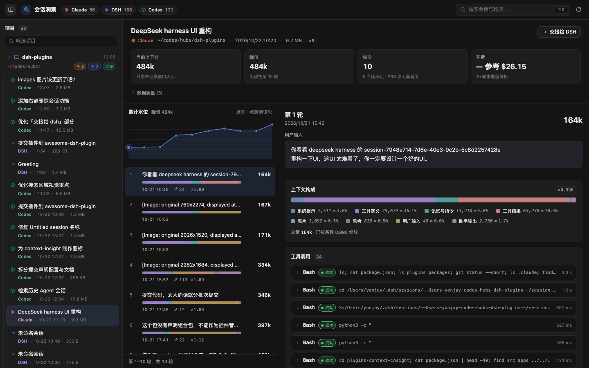
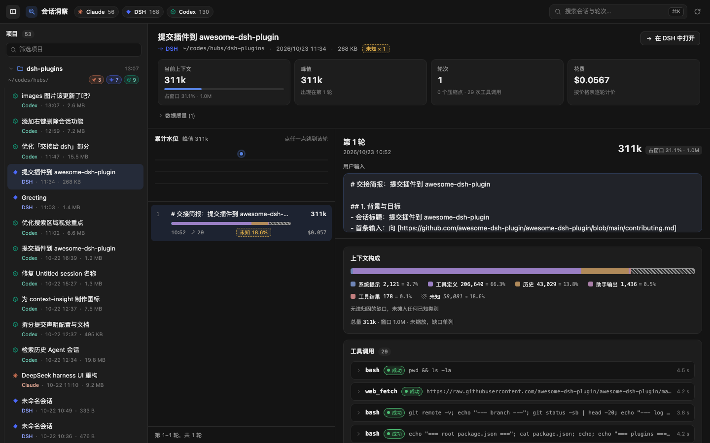
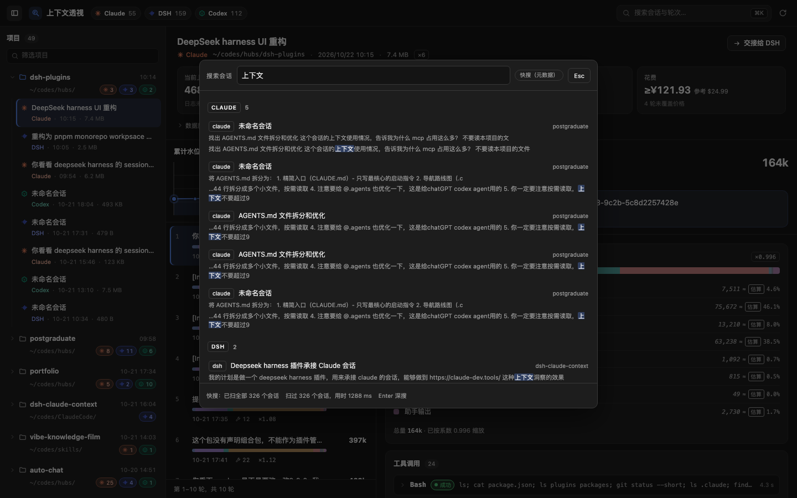
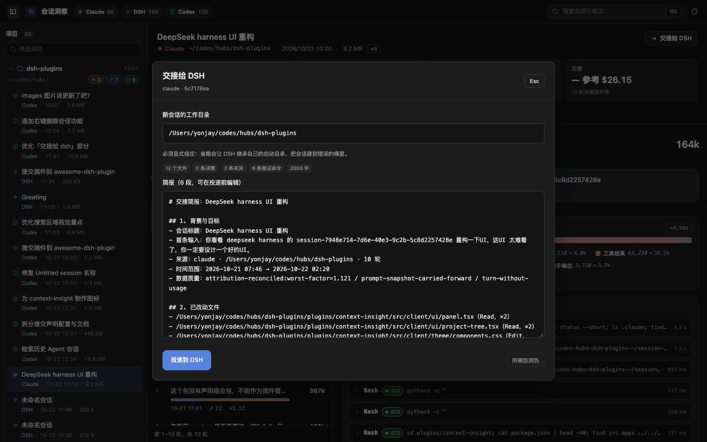

English | [简体中文](./README.zh.md)

# Sessions Insight · dsh-sessions-insight

A **Sessions Insight** panel for the DSH Web GUI. It parses session logs from **Claude Code, DSH and Codex** and shows what the model actually received on each turn — system prompt, tool definitions, memory & instructions, history, tool results, images — and marks every number as an exact usage figure or a character-based estimate.



> Insight reads never rewrite source logs. Right-click a session and confirm Delete session to permanently remove its original logs.

> **Current scope**: read-only insight, the summary handoff, confirmed deletion, and a settings page with two opt-in utilities (DeepSeek balance and update checks). The handoff delivers a generated brief into a new DSH session and **only calls the official `session.create` / `session.prompt`** — it never hand-writes session events and never rewrites the source session (`docs/HANDOFF.md`, `docs/adr/0003-never-handwrite-session-events.md`, `docs/adr/0007-accepted-is-not-success.md`).

## What it answers

- Of this turn's 392K window, how much is tool schemas, and how much is history?
- Why does the window jump after turn 7 — where is the compaction point, and what were the sizes before and after?
- Is 29,018 a usage figure from the log or a chars/token estimate? Every value carries an `exact` / `estimate` badge plus its basis.
- Across all three sources, how many sessions and turns does a workdir hold, and when was it last touched?



## The interface

**The workdir is the only axis; the source is just a badge.** `workdir → session → turn`

- **Toolbar**: each source's availability and session count (an unreadable source dims, hover for the reason). Clicking a source pill shows only that source's projects and sessions; click several to combine them, click again to clear. Search, refresh and the project-column toggle sit on the right.
- **Project tree**: grouped by workdir, filterable by path and by the toolbar's source pills; sessions hang under their project with a source mark, time and file size. The list reads file headers only and parses a session when you open it, so the first open of a big file pays the decode cost.
- **Session head**: title, source and path, then four stat tiles: current context (share of the window, amber above 80%), peak (and the turn it hit), turns (with compactions and tool calls), and cost.
- **Turn column**: the "cumulative level" chart plots each turn's total context, dashed verticals mark compactions, and clicking a point opens that turn. Below it, one row per turn: the user's words, token count, composition bar, time, tool calls, scaling factor and cost, aligned column by column. Turns load 40 at a time, with "load more turns" at the bottom.
- **Detail column**: "Turn N" and the user's words stay pinned at the top; beneath them come the context composition (every part carries an `exact` / `estimate` badge), compactions, tool calls (folded to one-line summaries, failed ones open themselves) and subagent sessions.
- `⌘K` (`Ctrl+K` on Windows/Linux) opens full-corpus search; a hit jumps straight to that turn.



## Hand off to DSH

Open a Claude Code or Codex session and click **Hand off to DSH**. Preview and edit the generated brief, confirm the working directory, then click **Deliver to DSH**. The brief has six sections: background and goals, changed files, decisions, open questions and risks, next steps, and verification commands.



## Settings, balance and update checks

The settings page is reachable from the **Settings** button in the panel toolbar and from the package details section under DSH settings. It is driven by the Host configuration form; **all six switches are saved by the Host** and the plugin writes no config file:

| Switch | Default | Effect |
| --- | --- | --- |
| Session overview | on | Show the Overview tab in the session detail |
| Skills tab | on | Show the Skills tab |
| Cumulative level chart | on | Show the context-level chart on the Turns page |
| Expand tool list by default | off | Open a session with every tool call expanded |
| DeepSeek balance display | off | Show the balance panel |
| Automatic version checks | off | Check the registry for a newer package version |

**Both utilities are off by default.** Enabling a switch — or pressing its button — is the only thing that makes the plugin go out. Outbound traffic is limited to two fixed endpoints, `https://api.deepseek.com/user/balance` and `https://registry.npmjs.org/@cyrusdoyle%2F<package>/latest`, with no redirects, no cookies and no caller-controlled URL.

- **Balance** (30 s cache, failures are not cached, an empty wallet list shows as "no balance"): follows the credential reference configured for the **DeepSeek official adapter** — its `apiKeyEnv` (default `DEEPSEEK_API_KEY`) is read from the Host settings service on every request, so renaming it on the Models page takes effect without a restart. When the Host settings service or that entry is missing, or the field is invalid, the lookup silently falls back to the default reference and then to the signed-in DeepSeek account. Only that official adapter's reference is followed: pi-ai and other custom providers keep their own refs. The plugin never stores or logs the key. A Host credential update invalidates the cache, so a new API key takes effect on the next request. The route makes at most six provider-triggering reads per minute and answers `429` (`rate-limited`) beyond that; cached reads do not count. Failures are shown as plain sentences (`credential-error` / `unauthorized` / `rate-limited` / `timeout` / `network` / `http-error` / `invalid-response` / `account-error`, plus a synthesized `host-unavailable` when the route cannot be reached).
- **Version check**: compares the **effective package** — the collection when installed as `@cyrusdoyle/dsh-plugins`, this member when installed standalone — against the same package on npm. Successful checks cache for 1 h, failures for 5 min. `HEAD` probes only read the cache, so a liveness check never goes to the network; the manual button always forces a check.
- The routes are fenced where they touch account data: `/balance` accepts loopback callers only, answers `HEAD` with 405 and limits provider-triggering reads to six per minute (`429` beyond that); `/settings` is read-only (writes go through the Host form). Full contract in `docs/API.md`.

The settings form needs **DSH 0.2.1-rc.5+** (`configForms` plus the `plugins.bundle.config` slot); on an older Host it shows the reason and a Retry button instead of a permanently read-only page.

## Sources and their roots

| Source      | Default root         | Override                          |
| ----------- | -------------------- | --------------------------------- |
| Claude Code | `~/.claude/projects` | `DSH_CONTEXT_INSIGHT_CLAUDE_ROOT` |
| DSH         | `~/.dsh/sessions`    | `DSH_CONTEXT_INSIGHT_DSH_ROOT`    |
| Codex       | `~/.codex/sessions`  | `DSH_CONTEXT_INSIGHT_CODEX_ROOT`  |

A missing or unreadable source never takes the others down: the strip at the top marks just that source "unavailable" and gives the reason (root missing / unreadable / adapter error).

## Install

Requires DSH **0.2.1-rc.5 or newer** — the settings page needs the `configForms` client service and the `plugins.bundle.config` slot introduced in that version. The plugin follows the behaviour of the running `app.asar`; see `docs/adr/0002-asar-021-is-the-contract.md`.

**Step 0 — know which profile you are installing into**

Installing into the wrong profile does not error; the panel just never appears. These are two different profiles, not one configuration:

| How you start DSH                             | Actual profile | Flag                |
| --------------------------------------------- | -------------- | ------------------- |
| Double-click `DeepSeek Harness.app` (desktop) | `desktop`      | `--profile desktop` |
| `dsh web` (command line / remote)             | `web`          | `--profile web`     |

When unsure, check the process arguments, or which directory under `~/.dsh/profiles/` is being updated.

**Step 1 — install into the profile**

To install just this plugin:

```sh
dsh plugin --profile desktop add @cyrusdoyle/dsh-sessions-insight   # desktop app
dsh plugin --profile web     add @cyrusdoyle/dsh-sessions-insight   # dsh web
# from a checkout, a packed tarball, or Git — lib/ is committed, so Git installs need no build:
# dsh plugin --profile <name> add link:$PWD
# dsh plugin --profile <name> add /abs/path/cyrus-dsh-sessions-insight-<version>.tgz
# dsh plugin --profile <name> add github:Mt-Youya/dsh-plugins#path:/plugins/sessions-insight
```

You can also install the collection `@cyrusdoyle/dsh-plugins`, which brings in every plugin of the collection (see the [repository README](../../README.md)).

> **Pick one of the two.** The collection and this plugin both insert `id: sessions-insight` into the loader tree; with both in `dsh.profile.bundles`, DSH fails at boot with `duplicate loader entry id: sessions-insight`.

**Step 2 — make sure the package is listed in `dsh.profile.bundles`**

In practice `dsh plugin ... add` also appends the package name to the end of `dsh.profile.bundles` in `~/.dsh/profiles/<name>/package.json`. If it did not (a `link:` install, a hand-edited manifest, or an upgrade from an older layout), add it yourself — order matters, later layers override earlier ones:

```json
{
  "dsh": {
    "profile": {
      "bundles": ["@deepseek-ai/dsh-base", "@deepseek-ai/dsh-web-app", "@cyrusdoyle/dsh-sessions-insight"]
    }
  }
}
```

**Step 3 — restart**

```sh
dsh web
```

A "Sessions Insight" row in the sidebar means it mounted. (The marketplace also has an unrelated dsh-context plugin with a similar name.) Host-side smoke test (a request without an `Origin` header counts as same-origin):

```sh
curl -sS http://127.0.0.1:<port>/api/dsh-sessions-insight/health
# {"ok":true,"value":{"version":"<version>","sources":["claude","dsh","codex"]}}
# value.version is the host-side PLUGIN_VERSION constant, injected from package.json at build time
```

> Loader rows are composed at boot, so **a restart is required**. Browser hot-reload only covers a rebuilt client bundle.

## Permissions and security boundary

- **Confirmed deletion**: right-click sessions from any source to delete their original logs and refresh the list. Shared Codex logs are protected; sidecar files and host indexes are retained.
- **The plugin stores nothing itself**: no index, no cache files; settings live in the Host configuration form; utility results are in-memory only (30 s / 1 h TTLs). The in-process LRU keys on `source + id + mtime + size`.
- **Path allowlist**: every path argument is resolved and `realpath`-checked to stay inside the three allowed roots, which blocks `..` and symlink escapes.
- **Same-origin gate**: every route is `kind:'exact'` and passes an Origin/Host gate first — `Sec-Fetch-Site: cross-site` is a 403, a mismatched `Origin`/`Host` is a 403, a same-origin GET without `Origin` passes. `/settings` is read-only, `/balance` is additionally loopback-only and rejects `HEAD` with 405.
- **Writes**: settings changes go through the Host's configuration form; the plugin's own write routes are the handoff (`handoff/apply` uses the official `session.create` + `session.prompt`; `handoff/reveal` creates or reuses a workspace for an existing session) and confirmed session deletion. Utility routes only read.
- **Outbound network**: only the two fixed HTTPS endpoints listed above, and only after a utility is enabled or its button pressed — no redirects, no cookies, no caller-controlled URL; requests have an 8 s (registry) or 30 s (balance) absolute deadline and a 128 KiB response cap.
- **Credentials**: the balance check resolves the credential reference configured for the **DeepSeek official adapter** (`apiKeyEnv`, default `DEEPSEEK_API_KEY`) through the Host credential service on every read, falling back to the signed-in account; settings lookups that are missing or invalid silently use the default reference. Only the official adapter is followed — other providers' refs are not. The key is never persisted or logged.
- **Read limits**: single-file decoding is byte-capped and answers `read-limit` instead of starving the Host.

## Known limitations

1. **Search has a 2.5 s budget.** Full-corpus search streams and stops at `SEARCH_DEADLINE_MS = 2500`: the response carries `truncated: true` and `remaining` (sessions not reached), and the UI says "not finished within budget, N sessions left". On a very large corpus, narrow the sources or drill down by workdir instead.
2. **Claude sessions without `prompt_snapshot` show a large "unknown" slice.** Those sessions (56 of 121 files in this corpus) cannot see tool definitions or the system prompt, so that share stays in `residual` and is drawn as an explicit "unknown" slice — it is **never** smeared into the other categories on purpose. See `docs/adr/0005-honest-attribution-residual.md`.
3. **Codex reasoning is unavailable.** `response_item.reasoning.encrypted_content` is ciphertext: countable, not measurable, so Codex turns show no "thinking" block.
4. **Blocks are estimates; totals are exact.** Blocks use 2.6 chars/token, which runs ~23% high on instruction bodies; turns that were equalised carry a `reconciled.factor` (see `docs/adr/0006-projection-not-differencing.md`). Do not bill from block numbers.
5. **DSH bodies require decoding the log.** The projcache holds metadata only, so opening a session still means frame-by-frame zstd decoding; multi-MB sessions pause noticeably on first open.
6. **A handoff's `delivered` is the instant of delivery, not a state you can keep observing.** The Host emits `turn/start` within about 30 ms of accepting the prompt, so the only stable states polling can see are `running` / `succeeded` / `failed`. Success means `turn/end reason=completed`; see `docs/adr/0007-accepted-is-not-success.md`.
7. **Cost comes from several price tables side by side, with no currency conversion.** There are two tables, each with its own `version` / `asOf` / `source`:
   - `official` (USD): DeepSeek's official pricing page, using the **peak price** as a conservative upper bound (cacheWrite counts as 0, since the official price only distinguishes cache hit and miss);
   - `openrouter` (USD): public reference prices taken from `/api/v1/models`, shown only in the "reference" column.

   The primary amount comes only from `official`: DeepSeek models are priced, while Claude/GPT have no primary amount (`null`, never estimated) and show the openrouter reference column only. When one session mixes currencies, totals are grouped by `(table, currency)` and shown side by side, **never added across tables or currencies, and never converted**. An unlisted channel is not free: it counts as 0, the amount gets a `≥` prefix and is marked `partial`. Use these numbers to understand the shape of usage, not to reconcile a bill.

## Layout

This package owns the plugin's two halves; the capabilities live in the workspace packages it depends on. Dependencies point one way — `plugins/sessions-insight → packages/*` — and the mapping from package name to source lives in `tooling/aliases.ts`, mirrored by `paths` in `tsconfig.json`.

**This package**, `plugins/sessions-insight/src/`:

```
src/
├── index.ts          host entry: assembles the three sources, registers the routes (the only file that touches cordis)
├── config.ts         settings schema and live-ref reader for the six switches
├── protocol.ts       this plugin's wire entry: re-exports protocol/ plus the contract package's IR, types and guards
├── protocol/         route paths and wire payloads per feature (paths, management, insights, ai-title, settings, utilities)
├── version.ts        version constant, injected from package.json at build time
├── shared/           parsing both halves need: insights extraction and skill evidence
├── host/             host half
│   ├── http/         same-origin gate, envelope, route table and one handler per route (routes.ts + *-route.ts), list cache, rate limit
│   ├── management/   user titles and groups (metadata store), AI title generation, metadata projection
│   ├── sources/      the three sources, workdir merge, snapshot index, path allowlist
│   ├── utilities/    balance and version checks: credential refs, HTTPS client, semver
│   ├── views/        search / cost / pricing / brief / insights
│   └── handoff/      handoff state machine (accepted ≠ success)
└── client/           browser half
    ├── index.tsx     entry: registers the sidebar/main slots and the dictionary
    ├── api.ts        same-origin fetch + response decoding
    ├── styles.ts     injects the compiled CSS once
    ├── locale/       zh/en dictionaries, per-feature tables and the locale resolver
    ├── model/        pure model logic: formatting, labels, tree flattening, turn rows, bar arithmetic, session stats
    ├── state/        fetch and refresh state: list cache, settings, management, utilities
    ├── theme/        app.css, components.css and the generated.css.ts build artefact
    └── ui/           components: panel, toolbar, project tree, session head, turn list and detail, tool detail, handoff, search palette, settings…
```

**The packages it depends on** (`packages/`, inlined into `lib/` at build time, never published on their own):

```
packages/
├── plugin-kit/         zero-dependency base: the JSON envelope and URL spelling
├── session-contract/   the unified IR, wire types and their guards      → plugin-kit
├── session-readers/    Claude / Codex / DSH readers and measurement      → session-contract
├── plugin-kit-host/    route table, same-origin gate, envelope, LRU      → plugin-kit
└── plugin-kit-client/  decoding fetch, style injection, slot registration → plugin-kit
```

## Development

Run these from the **repository root** (this package is not a repository of its own):

```sh
pnpm install
npx tsc --noEmit                          # type gate: the packages and the host half
npx tsc --noEmit -p tsconfig.client.json  # type gate: the browser half (types: [], no node types)
npx vitest run                            # unit tests
node scripts/build-css.mjs plugins/sessions-insight
npx tsdown --config plugins/sessions-insight/tsdown.config.ts --minify
node scripts/check-bundle.mjs plugins/sessions-insight   # host loading contract
```

Inside the package you can also build just this half: `pnpm --filter @cyrusdoyle/dsh-sessions-insight build` (that is `css + tsdown`).

Commit the `lib/` artifacts alongside the source so Git installs use prebuilt entries without requiring build-script approval. After changing source, rebuild before committing and include the artifacts. Keep `prepack` to rebuild and validate when packing.

Two entries are produced:

- `lib/index.js` — host half (ESM, runs in the Host's `node:vm` realm)
- `lib/client.js` — browser half; must be wrapped in `window.__ModuleLoader__.load({ id, factory })` with `react` external

To try a mount without touching a production profile, use an isolated `DSH_HOME`:

```sh
export DSH_HOME=/tmp/dsh-try
dsh try --from-default-profile web --dump-config   # create the profile from the built-in template, print the composed tree
dsh plugin --profile try add "$PWD"
# then append the package name to dsh.profile.bundles in profiles/try/package.json
dsh try --dump-config | grep -A2 sessions-insight    # confirm the patch row landed
dsh try --host 127.0.0.1 --port 49744 --no-open     # boot on its own port
```

## Documentation

These live at the **repository root**, not inside this package (the npm tarball only ships `docs/images`):

- `docs/RELEASE.md` — publishing to npm
- `docs/PLAN.md` — decisions and milestones (Chinese, like the rest below)
- `docs/IR.md` — the unified turn IR (adapter contract)
- `docs/API.md` — host route contract
- `docs/HANDOFF.md` — handoff contract
- `docs/adr` — architecture decision records
- `GLOSSARY.md` — vocabulary

## License

[MIT](./LICENSE)
