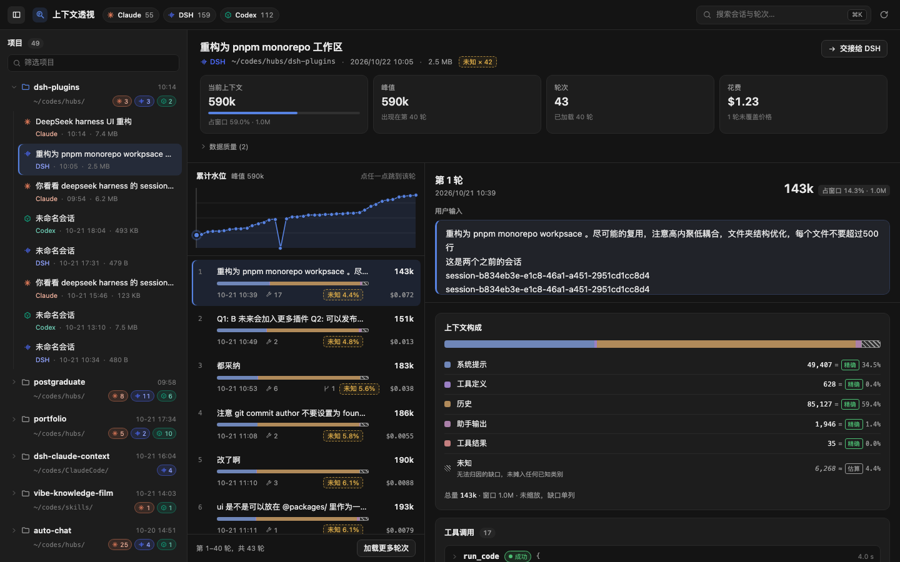
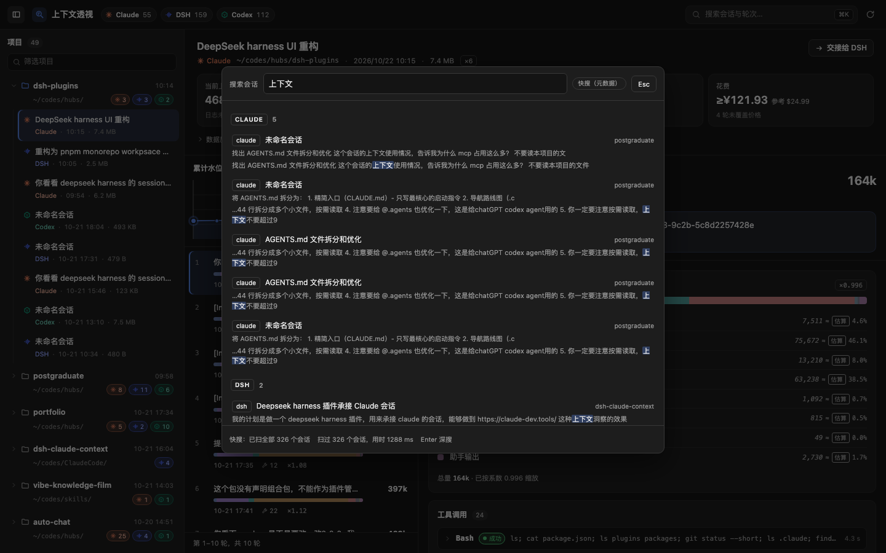

[English](./README.en.md) | 简体中文

# 会话洞察 · dsh-sessions-insight（Sessions Insight）

DSH Web GUI 的只读「会话洞察」面板：解析 **Claude Code / DSH / Codex** 三个来源的会话日志，把**模型每一轮实际收到的上下文**拆开给人看——系统提示、工具定义、记忆与指令、历史、工具结果、图片各占多少，以及每个数字是精确的 usage 还是按字符折算的估算。


> 全程只读：不写源数据、不建索引、不落盘。唯一的缓存是进程内 LRU，进程结束即消失。

> **当前范围**：只读洞察 + 摘要交接。交接把生成好的简报投递进 DSH 新会话，**只调官方 `session.create` / `session.prompt`**，不手写会话事件、不改写原会话（`docs/HANDOFF.md`、`docs/adr/0003-never-handwrite-session-events.md`、`docs/adr/0007-accepted-is-not-success.md`）。

## 它能回答什么

- 这一轮 392K 的上下文里，工具 schema 占了 95% 还是 5%？历史又被压缩换掉了多少？
- 同一个会话在第 7 轮之后为什么突变——压缩点在哪，前后窗口各是多少？
- 这个 29,018 是日志里的 usage，还是 chars/token 折算？每个数值都带 `精确` / `估算` 徽标与口径。
- 三个来源里，某个工作目录一共有多少会话、多少轮、最近一次是什么时候？



## 界面

**工作目录是唯一主轴，来源只是徽标。** `工作目录 → 会话 → 轮次`

- **顶栏**：三个来源各自的可读状态和会话数（读不到会变暗，悬停看原因）、搜索、刷新、收起左栏。
- **左栏项目树**：按工作目录分组，可以筛选；会话挂在项目下，带来源标记、时间和文件大小。列表只读文件头，点开会话才解析正文，所以大文件首开要等解压与解码。
- **会话头部**：标题、来源、路径，以及四个指标卡：当前上下文（占窗口的比例，超过 80% 变黄）、峰值（出现在第几轮）、轮次（压缩点与工具调用数）、费用。
- **轮次列**：顶部「累计水位」折线是每轮总上下文的走势，虚线竖条是压缩点，点任一点跳到那一轮。下面每行一轮：用户输入、token 数、构成条、时间、工具调用数、缩放系数和费用，各列上下对齐。每页 40 轮，底部「加载更多轮次」。
- **详情列**：「第 N 轮」和用户输入固定在顶部，下面依次是上下文构成（每个分区带 `精确` / `估算` 徽标）、压缩点、工具调用（默认折叠成一行摘要，报错的自动展开）、子代理会话。
- `⌘K`（Windows/Linux 上 `Ctrl+K`）打开全库搜索，命中后直接跳到那一轮。



## 三源与读取位置

| 来源        | 默认根目录           | 覆盖用的环境变量                  |
| ----------- | -------------------- | --------------------------------- |
| Claude Code | `~/.claude/projects` | `DSH_CONTEXT_INSIGHT_CLAUDE_ROOT` |
| DSH         | `~/.dsh/sessions`    | `DSH_CONTEXT_INSIGHT_DSH_ROOT`    |
| Codex       | `~/.codex/sessions`  | `DSH_CONTEXT_INSIGHT_CODEX_ROOT`  |

某个来源缺失或不可读不影响其余来源：顶部只把该源标为「不可用」，并给出原因（根目录不存在 / 不可读 / 适配器异常）。

## 安装

需要 DSH **0.2.1-rc.2 或更高**（插件按运行版 `app.asar` 内的行为对齐，见 `docs/adr/0002-asar-021-is-the-contract.md`）。

**第 0 步：先确认装进哪个 profile**

装错 profile 不会报错，只是**面板不会出现**。两者是不同的 profile，不是同一份配置：

| 你怎么启动                            | 实际 profile | 命令                |
| ------------------------------------- | ------------ | ------------------- |
| 双击 `DeepSeek Harness.app`（桌面端） | `desktop`    | `--profile desktop` |
| `dsh web`（命令行 / 远程）            | `web`        | `--profile web`     |

不确定时看进程参数或 `~/.dsh/profiles/` 下哪个目录在更新。

**第 1 步：把包装进 profile**

单独安装本插件：

```sh
dsh plugin --profile desktop add @cyrus/dsh-sessions-insight   # 桌面端
dsh plugin --profile web     add @cyrus/dsh-sessions-insight   # dsh web
# 本地开发时换成目录或打包产物：
# dsh plugin --profile <name> add link:$PWD
# dsh plugin --profile <name> add /abs/path/cyrus-dsh-sessions-insight-<版本>.tgz
```

也可以装组合包 `@cyrus/dsh-plugins`，它会把合集里的插件一起装上（见[仓库根 README](../../README.md)）。

> **两种方式只能选一种。** 组合包和本插件都会往加载树里插 `id: sessions-insight`，两个都在 `dsh.profile.bundles` 里时，DSH 启动会报 `duplicate loader entry id: sessions-insight` 并退出。

**第 2 步：确认包名在 `dsh.profile.bundles` 里**

实测 `dsh plugin ... add` 会顺带把包名追加到 `~/.dsh/profiles/<name>/package.json` 的 `dsh.profile.bundles` 末尾。**没自动加上时**（`link:` 安装、手改过 package.json、或从旧版本升级）手工补齐——顺序有意义，后面的层覆盖前面的层：

```json
{
  "dsh": {
    "profile": {
      "bundles": ["@deepseek-ai/dsh-base", "@deepseek-ai/dsh-web-app", "@cyrus/dsh-sessions-insight"]
    }
  }
}
```

**第 3 步：重启**

```sh
dsh web
```

侧边栏出现「会话洞察」一行即挂载成功。（市场里另有一个 dsh-context 插件叫「上下文洞察」，两者无关。）宿主侧自检（不带 `Origin` 头视为同源）：

```sh
curl -sS http://127.0.0.1:<port>/api/dsh-sessions-insight/health
# {"ok":true,"value":{"version":"<版本号>","sources":["claude","dsh","codex"]}}
# value.version 是宿主侧常量 PLUGIN_VERSION，构建时从 package.json 注入
```

> loader 行只在 boot 时组合，**改完必须重启**；浏览器热重载只覆盖「客户端 bundle 被重建」这一种情况。

## 权限与安全边界

- **只读**：三个源目录只做 `stat` 与读文件，从不写、不删、不改名。
- **不落盘**：不建索引、不写缓存文件；进程内 LRU 以 `source + id + mtime + size` 失效。
- **路径白名单**：所有路径参数先解析、再做 `realpath` 校验，必须仍落在三个白名单根目录之内——挡掉 `..` 与符号链接逃逸。
- **同源校验**：每条路由都是 `kind:'exact'`，先过 Origin/Host 门：`Sec-Fetch-Site: cross-site` 直接 403，`Origin` 与 `Host` 不一致 403；不带 `Origin` 的同源 GET 放行。
- **写路径只有交接**：查询面全是 GET（`health` / `sources` / `workdirs` / `sessions` / `session` / `search` / `cost`）；唯一的写动作是 `handoff/apply`，它只调官方 `session.create` + `session.prompt`——不写源目录，也不往活会话里塞事件。
- **读取上限**：单文件解码有字节上限，超限返回 `read-limit`，不会把宿主拖死。

## 已知限制

1. **搜索有 2.5 秒预算。** 全库搜索是流式的，达到 `SEARCH_DEADLINE_MS = 2500` 就停：响应里 `truncated: true`、`remaining` 是没轮到的会话数，界面显示「预算内未扫完，还剩 N 个会话」。语料特别大时请缩窄来源，或按工作目录逐层点开。
2. **Claude 会话没有 `prompt_snapshot` 时，面板会显示一大块「未知」。** 这类会话（本机语料 121 个文件里 56 个）看不到工具定义与系统提示的原文，那一份只能留在 `residual` 里显式画成「未知」切片，**不会**等比摊进其他类别。这是有意为之，见 `docs/adr/0005-honest-attribution-residual.md`。
3. **Codex 的思维链拿不到。** `response_item.reasoning.encrypted_content` 是密文，只能计数、无法测量，因此 Codex 轮次不显示「思考」分块。
4. **分块数字是估算，总量才是精确值。** 分块按 2.6 chars/token 折算，对指令体偏高约 23%；做过等比对账的轮次会显示 `reconciled.factor`（见 `docs/adr/0006-projection-not-differencing.md`）。不要拿分块数字做计费。
5. **DSH 正文必须解日志。** projcache 只有元数据、没有正文投影，看内容时仍要逐帧解压会话日志，几 MB 的会话首开有明显停顿。
6. **交接的 `delivered` 是投递瞬间的状态，不是可持续观察的状态。** 宿主接受 prompt 后约 30ms 内就会发出 `turn/start`，所以轮询能看到的稳定状态只有 `running` / `succeeded` / `failed`。成功判定以 `turn/end reason=completed` 为准，见 `docs/adr/0007-accepted-is-not-success.md`。
7. **成本是「多张价目表」并存的，不做汇率换算。** 共两张表，各自带 `version`/`asOf`/`source`：
   - `official`（USD）：DeepSeek 官方定价页，取 **peak 价**作为保守上界（cacheWrite 记 0——官方只按 cache hit/miss 计价）；
   - `openrouter`（USD）：公开参考价，从 `/api/v1/models` 抽取，只作「参考」列。

   主金额只取 `official`：DeepSeek 模型有主价，Claude/GPT 没有主价（`null`，不估算），只显示 openrouter 参考列。同一会话里出现不同币种时，合计按 `(表, 币种)` 分组并列，**绝不跨表或跨币种相加、也没有汇率换算**。价目里某通道未列价 ≠ 免费：该通道按 0 计入，金额前加 `≥` 并标 `partial`。这些数字用于理解用量结构，不要拿去对账。

## 目录结构

本包只有两个半边，能力在它依赖的 workspace 包里。依赖方向是 `plugins/sessions-insight → packages/*`，由包边界维持：包名到源码的映射在 `tooling/aliases.ts`，`tsconfig.json` 的 `paths` 与之对应。

**本包** `plugins/sessions-insight/src/`：

```
src/
├── index.ts          宿主入口：装配三源、注册路由（唯一碰 cordis 的文件）
├── protocol.ts       本包的线上契约出口：路由路径 + 转出契约包的 IR / 类型 / 守卫
├── version.ts        版本常量（构建时从 package.json 注入）
├── host/             宿主半边
│   ├── http/         同源门、信封、路由表（routes.ts + routes/）
│   ├── sources/      三源装配、工作目录归并、快照索引、路径白名单
│   ├── views/        search / cost / pricing / brief
│   └── handoff/      交接状态机（accepted ≠ 成功）
└── client/           浏览器半边
    ├── index.tsx     入口：注册 sidebar/main 槽位与词典
    ├── api.ts        同源 fetch + 响应解码
    ├── format.ts / labels.ts / locale.ts   格式化、标签回落、zh/en 词典
    ├── styles.ts     注入编译好的 CSS（一次）
    ├── state/        纯状态逻辑：树展平、轮次行、堆叠条算术
    ├── theme/        app.css、components.css、构建产物 generated.css.ts
    └── ui/           组件：面板、工具栏、项目树、会话头部、轮次列表与详情、工具明细、交接、搜索面板…
```

**它依赖的包**（`packages/`，构建时内联进 `lib/`，不单独发布）：

```
packages/
├── plugin-kit/         零依赖底座：JSON 信封、URL 拼法
├── session-contract/   统一 IR、线上类型、guards            → plugin-kit
├── session-readers/    Claude / Codex / DSH 三源适配与计量   → session-contract
├── plugin-kit-host/    路由表、同源门、信封、LRU             → plugin-kit
└── plugin-kit-client/  解码 fetch、样式注入、槽位注册         → plugin-kit
```

## 开发

这些命令都在**仓库根**执行（本包不是独立仓库）：

```sh
pnpm install
npx tsc --noEmit                          # 类型门禁：各包与宿主半边
npx tsc --noEmit -p tsconfig.client.json  # 类型门禁：浏览器半边（types: []，摘掉 node 类型）
npx vitest run                            # 单测
npx tsdown                                # 构建 lib/index.js 与 lib/client.js
node scripts/check-bundle.mjs plugins/sessions-insight   # 宿主加载契约
```

在包内也可以只构建自己：`pnpm --filter @cyrus/dsh-sessions-insight build`（等价于 `css + tsdown`）。

产物两个入口：

- `lib/index.js` — 宿主半边（ESM，在 Host 的 `node:vm` realm 里跑）
- `lib/client.js` — 浏览器半边，必须是 `window.__ModuleLoader__.load({ id, factory })` 包装，`react` 外置不打包

想验证挂载而不污染生产 profile，用隔离 `DSH_HOME`：

```sh
export DSH_HOME=/tmp/dsh-try
dsh try --from-default-profile web --dump-config   # 从内置模板建 profile，只打印组合树
dsh plugin --profile try add "$PWD"
# 再把包名追加进 profiles/try/package.json 的 dsh.profile.bundles
dsh try --dump-config | grep -A2 sessions-insight    # 确认 patch 行已插入
dsh try --host 127.0.0.1 --port 49744 --no-open     # 独立端口 boot
```

## 文档

这些文档都在**仓库根**，不在本包目录内（npm tarball 只带 `docs/images`）：

- `docs/RELEASE.md` — npm 发布步骤
- `docs/PLAN.md` — 决策与里程碑
- `docs/IR.md` — 三源统一的轮次 IR（adapter 契约）
- `docs/API.md` — 宿主路由契约
- `docs/HANDOFF.md` — 交接链路契约
- `docs/adr` — 架构决策记录
- `GLOSSARY.md` — 词表

## 许可

[MIT](./LICENSE)
